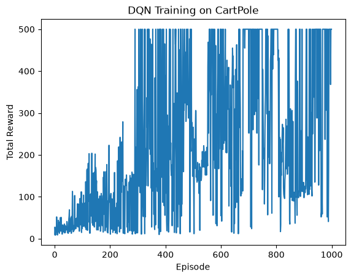

# Deep Q-learning for CartPole

[Open the notebook](../Reinforcement_learning.ipynb)

## Objective and approach

Train an agent to balance the pole in Gymnasium's `CartPole-v1` environment. A PyTorch network maps four state values through two 64-unit ReLU layers to action Q-values. The agent uses epsilon-greedy exploration, a replay buffer, mini-batch updates, and a periodically synchronized target network.

The supplied training loop runs 1,000 episodes with gamma 0.99, an Adam learning rate of 0.001, batch size 64, replay capacity 10,000, and target updates every 10 episodes. Epsilon decays from 1.0 toward 0.01.

## Run

Install `requirements-rl.txt` and run the notebook from top to bottom. No external dataset is required. The original package-install cell has been replaced by a setup note; install dependencies before opening the notebook. Training can take a while on CPU.

## Saved results

The supplied output records an average reward of **394.4** over the last 50 training episodes, with a minimum of **41.0**. Several recorded episodes reach 500 steps. These are training rewards, not an independent evaluation of a frozen policy. The printed comparisons to earlier runs are hard-coded exploratory notes.

## Limitations and next steps

Python, NumPy, PyTorch, and the environment are not fully seeded. The loop combines termination and time-limit truncation when masking the bootstrap target. Results vary between runs; use multiple seeds and a separate greedy-policy evaluation. Saving model checkpoints and logging moving-average rewards would make experiments easier to compare.
