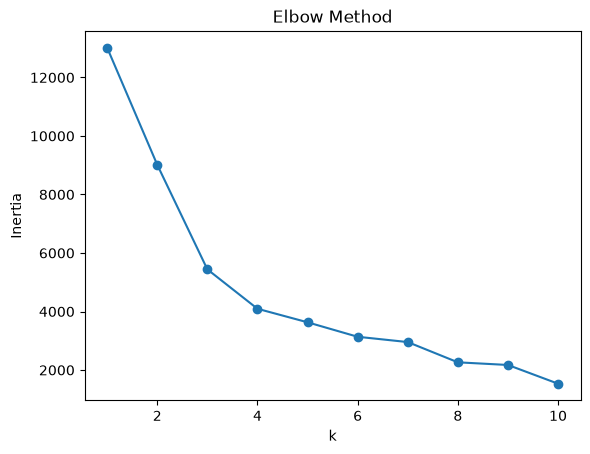

# Customer Segmentation with K-means

[Open the notebook](../Kmeans.ipynb)

## Objective and approach

Group retail customers by purchasing behavior. Clean transactions by removing missing customer IDs, cancellations, and non-positive quantities. Compute total spend and aggregate each customer's recency, invoice frequency, and monetary value (RFM), using the dataset's latest invoice date as the reference for recency.

Standardize RFM features and implement centroid initialization, cluster assignment, centroid updates, and inertia in NumPy. Plot inertia for k=1 through 10, then inspect a four-cluster solution.

## Run

Install `requirements.txt`, run `python scripts/download_datasets.py retail` from the repository root, and run the notebook in order.

## Saved results

The original four-cluster run records 4,339 customers. Its cluster sizes are 210, 3,053, 13, and 1,063. Mean RFM values distinguish frequent high-value shoppers, typical customers, a small group of very high spenders, and less recent low-spend customers. Cluster numbers are arbitrary identifiers.

## Limitations and next steps

RFM distributions are skewed and sensitive to outliers. The current empty-cluster update leaves its centroid at zero; reinitialization would be more robust. Labels are returned from the last assignment before the final centroid update. Consider log transformations, repeated initializations, silhouette analysis, and explicit handling of zero-price transactions before using segments for business decisions.

Data attribution: [UCI Online Retail](../DATASETS.md#online-retail).
