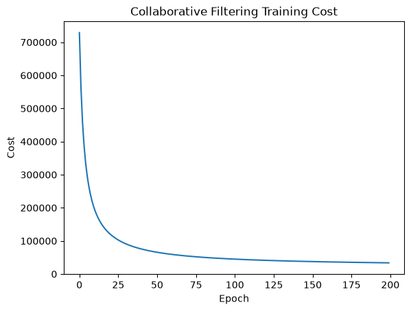

# Movie Recommendation Systems

[Open the notebook](../Collaborative_Filtering.ipynb)

## Objective and approach

Recommend unseen movies using two representations of preference:

1. **Collaborative filtering:** build a movie-user rating matrix and an observed-rating mask, center ratings by movie means, and learn 10-dimensional movie and user factors through regularized gradient descent.
2. **Content-based recommendations:** encode genres, build a weighted profile from movies the user rated highly, and rank unseen movies by cosine similarity.

The collaborative recommender excludes previously rated titles and supports a minimum-rating-count filter to reduce recommendations of sparsely rated movies.

## Run

Install `requirements.txt`. Run `python scripts/download_datasets.py movielens` from the repository root, or use the download cell inside the notebook. Run all cells in order. The dense matrix calculations may take several minutes and use substantial memory.

## Saved outputs

The notebook contains cost curves and example recommendations for user 1. It uses 100,836 ratings from 610 users over 9,724 rated movies in the supplied local data. No held-out recommendation metric is reported.

## Limitations and next steps

Factor initialization is unseeded. Training loss measures fit on observed training ratings, not performance on unseen ratings. Predictions are generated in centered-rating space; movie means are not added back for the recommendation ranking. Some saved training logs may reflect earlier executions. Add a held-out split, rating-scale predictions, RMSE and ranking metrics, and a popularity baseline. The training log condition checks `epochs % 20` rather than `epoch % 20`, so the supplied run prints each epoch.

Data credit and usage conditions: [MovieLens setup](../DATASETS.md#movielens-small).
